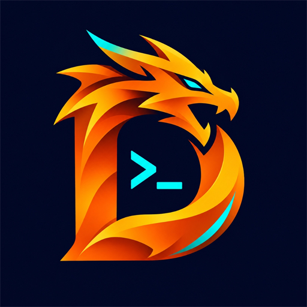

# DraGon
### Lingkungan Development Lokal Windows Modern & Cepat (.dra)

 

**DraGon** adalah lingkungan pengembangan web lokal (*local development environment*) untuk sistem operasi Windows yang dirancang sebagai alternatif modern, ringan, cepat, dan terintegrasi penuh untuk menggantikan Laragon maupun XAMPP.

---

## 🚀 Unduh DraGon Terbaru

Dapatkan versi rilis stabil terbaru langsung dari GitHub Releases:

| Paket Distribusi | Deskripsi | Tautan Unduh |
| :--- | :--- | :--- |
| **DraGon Setup (Installer Mandiri)** | Disarankan untuk instalasi baru. Termasuk biner aplikasi dan seluruh paket runtime esensial (Apache, PHP 8.3 LTS, MariaDB 11.4 LTS, Composer, Node.js, phpMyAdmin, Nginx). | [⬇️ **Unduh DraGon-Setup.exe**](https://github.com/dningratx/dragon/releases/download/v1.0.0/DraGon-Setup.exe) |
| **DraGon Portable (ZIP Archive)** | Versi portabel tanpa installer. Cukup ekstrak dan jalankan `DraGon.App.exe`. | [📦 **Unduh DraGon-win-x64.zip**](https://github.com/dningratx/dragon/releases/download/v1.0.0/DraGon-win-x64.zip) |

---

## ✨ Fitur Unggulan

### 1. 🐘 Multi-Versi PHP Berdampingan
- Beralih versi PHP aktif secara instan hanya dengan 1 klik.
- Mendukung preset rilis **PHP 8.3 LTS** (Rekomendasi), **PHP 8.4** (Terbaru), dan **PHP 8.2**.
- Manajemen ekstensi PHP (`php.ini`) terintegrasi langsung dari antarmuka aplikasi.

### 2. 🐬 Database MariaDB 11.4 LTS & MySQL
- Server database relasional SQL lokal yang cepat, aman, dan siap pakai.
- Dilengkapi tombol inisialisasi data otomatis (*Init Data*).
- Integrasi pintasan langsung ke **phpMyAdmin** dan **HeidiSQL GUI**.

### 3. 🌐 Web Server Ganda: Apache HTTP & Nginx
- Bebas memilih web server utama antara **Apache HTTP Server** (dengan `mod_rewrite` dan `.htaccess`) atau **Nginx**.
- Port HTTP (80) dan HTTPS (443) dapat disesuaikan tanpa bentrok dengan layanan lain.

### 4. 🔒 Otomatisasi SSL Lokal & VirtualHost (`https://*.dra`)
- Penerbitan sertifikat SSL lokal otomatis untuk setiap domain proyek.
- DraGon Local Root CA dapat dipasang ke Windows Certificate Store dengan 1 klik agar browser tidak menampilkan peringatan keamanan (*Not Secure*).
- Sinkronisasi instan domain lokal ke berkas hosts Windows (`127.0.0.1`).

### 5. ⚡ Pembuatan Proyek Baru Super Cepat
- **Ketik Nama Langsung Jadi:** Folder proyek dan domain `.dra` langsung dibuat di direktori workspace (`C:\DraGon\www\<nama>`).
- **Template Bawaan Siap Pakai:**
  - 📁 **Standar (PHP/Web):** Dilengkapi template awal `index.php` informatif (koneksi database, versi PHP, dan phpMyAdmin).
  - 🔴 **Laravel:** Otomatis mengeksekusi `composer create-project laravel/laravel` dan mengatur document root ke `public/`.
  - 🔵 **WordPress:** Otomatis mengunduh paket resmi WordPress terbaru dari `wordpress.org` dan mengekstraknya ke folder proyek.
  - 🐙 **Git Clone:** Cukup tempel URL repositori Git untuk meng-clone proyek langsung ke workspace.
  - 📂 **Impor Folder:** Mendaftarkan proyek yang sudah ada pada komputer Anda.

### 6. 💻 Terminal Pintar Terinjeksi Path Runtime
- Tombol Terminal terpasang langsung di antarmuka utama.
- Otomatis menyuntikkan seluruh lokasi eksekusi runtime DraGon (PHP, Composer, Node.js, MariaDB/MySQL, Git) ke dalam variabel lingkungan terminal.

---

## 📋 Persyaratan Sistem

- **Sistem Operasi:** Windows 10 (versi 2004 atau lebih baru) / Windows 11 (64-bit).
- **Arsitektur:** x64 (AMD64 / Intel 64).
- **Ruang Penyimpanan:** Minimal 1 GB ruang kosong untuk aplikasi dan runtime esensial.

---

## 🛠️ Panduan Pemasangan

1. Unduh berkas [**`DraGon-Setup.exe`**](https://github.com/dningratx/dragon/releases/download/v1.0.0/DraGon-Setup.exe).
2. Jalankan berkas installer tersebut (pilih direktori instalasi, default: `C:\DraGon`).
3. Selesaikan wizard instalasi dan jalankan **DraGon**.
4. Klik tombol **▶ Start** pada bilah atas untuk menjalankan seluruh layanan web dan database.
5. Buat atau buka proyek Anda di `C:\DraGon\www` dan akses melalui browser via domain `https://<nama-proyek>.dra`.

---

## 📄 Lisensi & Hak Cipta

Hak Cipta &copy; 2026 **dningratx**. Seluruh hak cipta dilindungi undang-undang.
DraGon didistribusikan secara gratis untuk keperluan pengembangan lokal.
